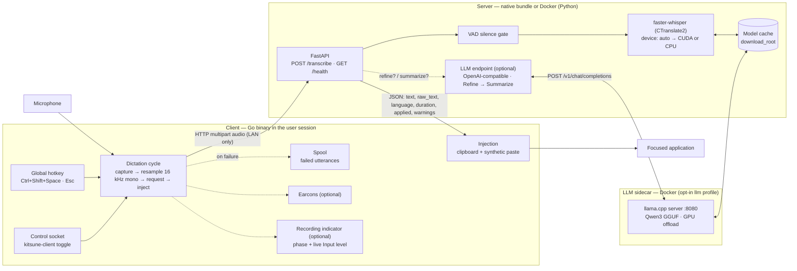
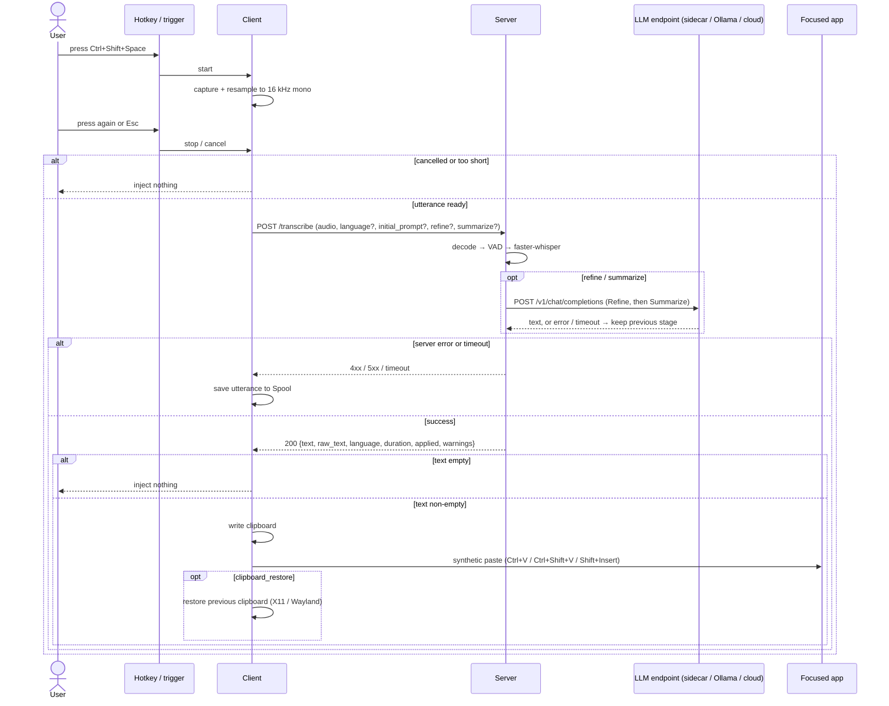

# kitsune-whisper

Private, LAN-local speech-to-text dictation for Windows and Linux. Press a global
hotkey, speak, press it again, and the transcription appears at your cursor —
audio never leaves your network.

- A Go **Client** runs in your logged-in user session, captures the microphone,
  resamples to 16 kHz mono, and injects the transcription via clipboard +
  synthetic paste.
- A Python **Server** transcribes with faster-whisper, auto-detects CUDA vs CPU,
  and exposes the authenticated `POST /transcribe` and `GET /status` plus an
  unauthenticated `GET /health`. It ships as a native
  per-user bundle (pinned runtime, no system Python or Docker) and as a Docker
  image for a dedicated host.
- An optional **LLM sidecar** (the official llama.cpp server, behind the opt-in
  `llm` compose profile) runs on your GPU for local Refine/Summarize. The Server
  talks to it — or to any OpenAI-compatible endpoint (Ollama, LM Studio, a cloud
  API) — over HTTP.
- All read one `kitsune.yaml` (each process reads only its own section).

## Quick Start

There is exactly one installation path per platform. The script installs the
Client, the native Server bundle, or both as your own files, verifies the
release signature and checksums, and stops there: **nothing is elevated,
started, enabled, or registered for autostart**. Re-running the same command
upgrades in place; configuration, models, and pairing survive.

### Linux

```sh
curl -fsSL https://raw.githubusercontent.com/FoxRed-cmd/kitsune-whisper/main/install.sh | bash
```

### Windows (PowerShell 7+)

```powershell
irm https://raw.githubusercontent.com/FoxRed-cmd/kitsune-whisper/main/install.ps1 | iex
```

Both components are installed by default. Install one with
`--client-only` / `--server-only` on Linux, or `-ClientOnly` / `-ServerOnly` on
Windows. Pin a release with `--version vX.Y.Z` (Linux) or `-Version vX.Y.Z`
(Windows), or with `KITSUNE_VERSION`.

Every flag is discoverable before anything changes:

```sh
curl -fsSL https://raw.githubusercontent.com/FoxRed-cmd/kitsune-whisper/main/install.sh | bash -s -- --help
curl -fsSL https://raw.githubusercontent.com/FoxRed-cmd/kitsune-whisper/main/install.sh | bash -s -- --check
curl -fsSL https://raw.githubusercontent.com/FoxRed-cmd/kitsune-whisper/main/install.sh | bash -s -- --dry-run
```

```powershell
& ([scriptblock]::Create((irm https://raw.githubusercontent.com/FoxRed-cmd/kitsune-whisper/main/install.ps1))) -DryRun
```

`--check` reports the installed and available versions plus the installed
components, and changes nothing. `--dry-run` prints the install plan and changes
nothing. To pass any flag through a piped Windows one-liner, wrap it as
`& ([scriptblock]::Create((irm …))) -Flag`.

After installing the Client, launch **kitsune-whisper** from the application
menu (Linux) or Start menu (Windows). The Client starts the Local Server when
one is installed. A Server-only install has no menu entry; drive it with
`kitsune-server` or leave it for another Client. Autostart is off until you turn
it on in **Settings → Startup**. The first-run wizard downloads the Whisper
model with progress; **nothing is downloaded at install time or when the Server
starts**.

You do **not** need Python, pip, a virtual environment, or Docker to install or
run kitsune-whisper. Docker remains an alternative for a dedicated Server host.
See [Dependencies](#dependencies) for the complete list.

## Dependencies

The installers install our binaries and nothing else. They check the runtime
surface and warn — a missing dependency never fails an install whose binaries
were written. Warnings point here; the full per-distribution matrix, exact
commands, and the removal steps for a rule you added are in
[`docs/dependencies.md`](docs/dependencies.md).

| Platform | Need | Without it |
| --- | --- | --- |
| Linux Client | GTK4 + WebKitGTK 6.0 | Settings opens in your browser instead of the embedded window |
| Linux Client | ALSA (`libasound.so.2`) | the Client cannot record |
| Linux Client | X11 (`libX11.so.6`) | hotkeys and X11 injection do not load |
| Linux Client | glibc `2.39` | the Client cannot run; a glibc `2.35` host can still run the Server |
| Linux Server | glibc `2.35` | the Server cannot run |
| Wayland Client | `wtype` (wlroots) or `ydotool` (GNOME/KDE, wlroots) | transcription only reaches the clipboard |
| Wayland Client | `/dev/uinput` access for `ydotool` | `ydotool` cannot inject; clipboard-only |
| Windows Client | Microsoft Edge WebView2 Runtime | Settings and the Tray cannot open |
| Windows | Windows 10 build 17763+ (1809), 64-bit | the release artifacts do not run |

Quick package commands (the full matrix has every manager and notes):

| Manager | GTK4 + WebKitGTK 6.0 + ALSA + X11 |
| --- | --- |
| apt (Debian/Ubuntu) | `sudo apt install libgtk-4-1 libwebkitgtk-6.0-4 libasound2 libx11-6` |
| dnf (Fedora) | `sudo dnf install gtk4 webkitgtk6.0 alsa-lib libX11` |
| pacman (Arch) | `sudo pacman -S --needed gtk4 webkitgtk-6.0 alsa-lib libx11` |
| zypper (openSUSE) | `sudo zypper install libgtk-4-1 libwebkitgtk-6_0-4 libasound2 libX11-6` |

On Wayland also install `wl-clipboard` and the injection tool for your session:
`wtype` on wlroots, `ydotool` on GNOME/KDE Plasma. Give `ydotool` access to
`/dev/uinput` with either a `uaccess` udev rule or an `input`-group rule plus
group membership; the exact commands, and how to remove a rule you added, are
in [dependencies.md](docs/dependencies.md#granting-uinput-access). The
installer never writes such a rule.

**Uninstall keeps configuration, models, and pairing state.** `--purge` /
`-Purge` removes every trace we created: configuration, models, certificates,
Device tokens, logs, Spool, and wizard progress. Neither command removes a
package you installed yourself, and neither removes a udev rule you added — that
is a manual step. The Linux and Windows uninstall commands and the exact
boundaries are in [install.md](docs/install.md#uninstall-and-purge).

Windows specifics: the build is unsigned, so SmartScreen may ask you to confirm
the first run; no Visual C++ redistributable is needed; and no scheduled task
runs at logon. CUDA is an optional documented step on both platforms
([dependencies.md](docs/dependencies.md#optional-cuda-runtime)).

## Architecture

The **Client** and **Server** talk HTTP over your LAN; the optional **LLM
sidecar** is a third container the Server calls the same way. Only the Client
touches the desktop (hotkeys, microphone, clipboard); the Server and sidecar
touch the models. Audio never leaves the network.

- **Client** (Go, user session) — binds the global hotkey, captures the
  microphone, resamples to 16 kHz mono, POSTs the utterance, then injects the
  returned text at the cursor. A small **Recording indicator** shows the current
  phase and live Input level while recording, with a clickable stop button; it
  is optional, never takes focus, and failure to create it degrades to silent
  dictation. On failure the Client saves the audio to the Spool instead of
  losing it.
- **Server** (Python + faster-whisper) — behind `POST /transcribe` it decodes the
  request, runs the VAD silence gate, transcribes on the auto-resolved device,
  and returns JSON. It can optionally post-process the text through an
  OpenAI-compatible LLM endpoint (see **Processing** below). The authenticated
  `GET /status` reports the resolved device, compute type, model, and whether
  processing is enabled; `GET /health` reports liveness, the version, and
  whether a model is loaded.
- **Processing** (optional) — a request may ask the Server to **Refine** (remove
  disfluencies, add punctuation) and/or **Summarize** (compress to the key
  points). Refine runs before Summarize. It is off by default and never makes
  transcription fail: a disabled, unreachable, timed-out, or empty step is
  skipped, the text falls back to the previous stage, and the response says why
  in `warnings`. The Server talks to any **OpenAI-compatible** chat-completions
  endpoint: the bundled llama.cpp sidecar (opt-in `llm` compose profile), an
  existing Ollama / LM Studio service, or a cloud API. It is configured under
  `server.processing` in `kitsune.yaml` and requested per utterance through the
  `/transcribe` API; the experimental switches are not exposed by the Client
  (the legacy `client.refine` / `client.summarize` keys are ignored with a
  warning). The built-in `base_url` is
  loopback, so processing stays local; the bundled `llm` profile points it at
  the sidecar instead, and an **external `base_url` sends the transcribed text
  off the host** (the audio still stays on your network).
- **Transport** — plain HTTP/1.1, one utterance per request (batch, no streaming
  in v1). `kitsune.yaml` is shared; each process reads only its own section.

### Components



### A Dictation cycle



## Docker Server on a dedicated host

The native per-user bundle is the default Server on a laptop or desktop that
also runs the Client. Docker remains supported for a **dedicated** host — for
example a GPU machine that stays on and serves other Clients. The two
deployments run the same Server code, API, TLS, Device tokens, Admin API, and
Model catalog; only storage differs.

### 1. Server + local LLM (Docker)

The fast path on an NVIDIA host: Docker runs the **Server** (CUDA) plus an
optional llama.cpp **sidecar** for local Refine/Summarize, and the Go **Client**
runs on your desktop. Nothing is compiled and nothing leaves the machine.

Prerequisite: a recent NVIDIA driver and **`nvidia-container-toolkit`** (Linux)
or Docker Desktop with WSL2 GPU passthrough (Windows) — see
[GPU prerequisites](#gpu-prerequisites). CPU-only and external-endpoint setups
are in [`docs/install.md`](docs/install.md).

```sh
mkdir -p config
cp kitsune.example.yaml config/kitsune.yaml
```

The Server mounts `./config` as a **writable directory**, not a single file:
the Admin API saves settings with an atomic rename inside that directory, so a
read-only file mount would break config writes. The image sets
`KITSUNE_CONFIG=/config/kitsune.yaml`, which `docker exec` also inherits, so
pairing inside the container reads the same file as the Server.

Turn processing on in `config/kitsune.yaml` — the Server master switch
(`server.processing.enabled` is `false` by default). A request then opts in with
its `refine` / `summarize` form fields; the Client does not send them, so this is
for direct API users:

```yaml
server:
  processing:
    enabled: true      # was false
```

Then start the Server and the matching sidecar (targeting both starts exactly
those two and auto-enables their profiles):

```sh
docker compose up -d server-gpu llama-gpu
```

The Server reads `/config/kitsune.yaml` (mounted from the directory above), so
restart it after later file edits (`docker compose restart server-gpu`). Hot
settings such as `log_level` can also be changed from the Admin API/Settings
window without a restart; the Server writes them back into
`config/kitsune.yaml`. The Client reads the `client:` section from its own
config; you can point it at this same file instead with
`--config ./config/kitsune.yaml` or
`KITSUNE_CONFIG=$PWD/config/kitsune.yaml`.

The Server downloads **no model when it starts**. Use the first-run wizard or
**Settings → Models** to download the Whisper model (and the sidecar's Qwen3
GGUF) into the shared `kitsune-models` volume; later runs reuse them. The Server
listens on `https://localhost:8765` with a self-signed certificate (the `-k`
flag below accepts it; the Client pins the fingerprint instead), and the sidecar
is reachable on the compose network as `llama` — which the Server services are
already pointed at.

Every transcription and management request needs a Device token. The loopback
auto-pairing path cannot see a Docker port forward as loopback, so a Docker
Server pairs with a one-time code generated inside the container (wait until
`/health` answers first, so the Server and the CLI do not race on the
certificate):

```sh
docker exec <container> kitsune-server pair
```

The command prints the config file it read, the code, its 10-minute expiry, and
the certificate fingerprint. In the Client's **Settings → Servers and Devices**,
enter `https://<host>:8765` (or your `KITSUNE_HOST_PORT`) and the code; the
Client pins the certificate and stores the Device token. The Device and pairing
stores, the TLS pair, the soft-stop flag, and the log live on the
`kitsune-state` volume, so they survive a container restart and recreation.
`GET /health` needs no token and reports `status`, `version`, and the model
state (`model`, `model_state`, `loaded`, `stopped`):

```sh
curl -k https://localhost:8765/health
```

A Server that has not loaded a model answers `loaded: false` with
`model_state: "cold"` and an empty `model`, and `POST /transcribe` returns
`503 model_unavailable` until the wizard downloads a model.

### 2. Client

Install the Client on the machine with the microphone and display. Installing
both components is the default; for a Docker Server use the Client alone
(`--client-only` / `-ClientOnly`) as described in [Quick Start](#quick-start).

The Client stores its Device token in the OS keychain (or a `0600` file) and
pins the certificate fingerprint into the profile. A Remote Server is added in
**Settings → Servers and Devices** with its address and a one-time Pairing code;
the same screen lists and revokes trusted Devices. Tokens never appear in
`kitsune.yaml` or in the logs.

Restart the Client after editing `kitsune.yaml`: use **Restart** in the Tray, or
relaunch it. If you turned autostart on, the registration exists and can be
restarted with `systemctl --user restart kitsune-client.service` (Linux) or
`Stop-ScheduledTask`/`Start-ScheduledTask -TaskName kitsune-client` (Windows).
Re-run the installer to upgrade; `--uninstall` / `-Uninstall` removes it, and
`--purge` / `-Purge` also removes user data. See
[`docs/install.md`](docs/install.md).

### 3. Dictate

With the Client running, press **Ctrl+Shift+Space** to start recording, speak,
and press it again to stop. The transcription is pasted into the focused field.
Press **Esc** to cancel without injecting. The hotkey and the cancel key are
configurable.

If the Server isn't reachable the Client reports it and saves the audio to the
Spool instead of losing your speech. An empty transcription injects nothing. If
the LLM sidecar is slow or down, Refine/Summarize is skipped and you still get
the raw transcription.

## The hotkey

- **Toggle**: press to start, press again to stop.
- **Cancel**: `client.cancel_hotkey` (default `Ctrl+Shift+Q`) aborts the utterance.
  On GNOME Wayland, Settings can install the shortcuts as GNOME custom
  keybindings (`kitsune-client toggle` / `kitsune-client cancel`); they stay in
  sync with the hotkeys above.

The defaults are `client.hotkey: Ctrl+Shift+Space` and
`client.cancel_hotkey: Ctrl+Shift+Q`. On Wayland, hotkeys are best-effort; see
[Wayland support and known limitations](docs/wayland.md).

## Server (Docker for a dedicated host)

For a laptop or desktop that already runs the Client, the native per-user bundle
is the default: the Client starts it on launch and can restart it, and running
it needs no system Python and no Docker. The bundle carries its own pinned
runtime and a `bootstrap.py`, so the installer works on a host with no system
Python (see [the native Server bundle](docs/server-bundle.md)). `install` pins
the config file it resolves into the supervisor, so the Client and the
supervised Server read the same `kitsune.yaml`; `kitsune-server status` prints
the pinned path, and Windows log output goes to
`%LOCALAPPDATA%\kitsune-whisper\server.log`.

The same Server also ships as a Docker image with two profiles:

| Profile | Base image | When to use |
| --- | --- | --- |
| `cpu` | `python:3.11-slim` | Any host; slower, no GPU needed |
| `gpu` | `nvidia/cuda:12.3.2-cudnn9-runtime-ubuntu22.04` | NVIDIA GPU; near-instant |

A dedicated host keeps its persistent data outside the container:

| Host | Container | Contents |
| --- | --- | --- |
| `./config/` (bind, writable) | `/config` | `kitsune.yaml`; the Admin API saves here. |
| `kitsune-state` volume | `/state` | TLS cert/key, Devices, pairing codes, soft-stop flag, log. |
| `kitsune-models` volume | `/models` | Whisper models and the optional llama.cpp GGUF. |

The published port is `${KITSUNE_HOST_PORT:-8765}` on the host and `8765`
inside the container; set `KITSUNE_HOST_PORT` in a `.env` next to
`compose.yaml` if 8765 is taken. `restart: unless-stopped` is what makes the
Client's restart (`202`, then exit `75`) bring the container back; a bare
`docker run` needs `--restart unless-stopped` and `-v` mounts for `/models` and
`/state`.

**Soft-stop vs stopping the container.** For a Remote Server, `POST /admin/stop`
(the Client's Stop in a remote profile) unloads the model and returns `503` for
transcription while the process, the Admin API, and `/health` stay up;
`/admin/start` reloads. The Client hard-stops only a Local Server profile.
`docker compose stop` or `docker stop` is a hard stop: `restart: unless-stopped`
will not bring a manually stopped container back until you `docker compose start`
it again.

**`down` vs `down -v`.** `docker compose down` removes the container and keeps
all three stores; the next `up` reuses the same certificate, Devices, models,
and settings. `docker compose down -v` deletes the named volumes too — the
certificate changes, so every Client must pair again, and the models are
downloaded again. Use it only for a deliberate fresh start.

An opt-in `llm` profile starts a bundled llama.cpp sidecar
(`ghcr.io/ggml-org/llama.cpp:server` / `:server-cuda`) for local
Refine/Summarize; start it with the matching Server
(`docker compose up -d server-gpu llama-gpu`, or `server-cpu llama-cpu` on a
CPU-only host). See
[Optional post-processing](docs/install.md#optional-post-processing).

### GPU prerequisites

The `gpu` profile needs the host to expose an NVIDIA GPU to Docker:

- **Driver**: a recent NVIDIA driver on the host (`nvidia-smi` must work). The
  container ships the CUDA 12.3 / cuDNN 9 runtime; only the driver comes from the
  host.
- **Linux**: install [nvidia-container-toolkit](https://docs.nvidia.com/datacenter/cloud-native/container-toolkit/latest/install-guide.html)
  and configure the Docker runtime, then restart Docker. Verify with
  `docker run --rm --gpus all nvidia/cuda:12.3.2-cudnn9-runtime-ubuntu22.04 nvidia-smi`.
- **Windows (WSL2)**: use Docker Desktop with the WSL2 backend and a distro with
  GPU passthrough; confirm `nvidia-smi` works inside WSL before starting.
- The image bundles `nvidia-cublas-cu12`, because the CTranslate2 wheel ships cuDNN
  but not cuBLAS. The authenticated `/status` reports the resolved
  `device`/`compute_type`, so you can confirm the GPU is actually in use.

### Recommended hardware

An **NVIDIA/CUDA GPU is recommended** for near-instant transcription; CPU-only
hosts are supported but slower. See
[`docs/install.md#recommended-hardware`](docs/install.md#recommended-hardware) for
the CPU escape hatch (`base`/`tiny`), the low-VRAM `int8_float16` note, and the
measured latency figures.

### Images

Images are published to GHCR by `.github/workflows/publish-server-image.yml`:

- `ghcr.io/foxred-cmd/kitsune-whisper-server:cpu`
- `ghcr.io/foxred-cmd/kitsune-whisper-server:gpu`

Tagged releases (`v*`) publish as `vX.Y.Z-cpu` / `vX.Y.Z-gpu`; pushes to `main`
publish `cpu` / `gpu`. To build locally instead:

```sh
docker compose --profile cpu build
docker compose --profile gpu build
```

## Documentation

- [`docs/install.md`](docs/install.md) — installers, paths, flags, autostart, upgrade/uninstall, hardware.
- [`docs/dependencies.md`](docs/dependencies.md) — the full dependency matrix, glibc floors, injection tools, uinput, CUDA.
- [`docs/configuration.md`](docs/configuration.md) — the full `kitsune.yaml` reference.
- [`docs/security.md`](docs/security.md) — TLS, Device tokens, pairing, revocation, LAN exposure.
- [`docs/models.md`](docs/models.md) — model catalog, download/activate/delete, idle unload, CUDA.
- [`docs/troubleshooting.md`](docs/troubleshooting.md) — diagnostics, logs, common failures.
- [`docs/release.md`](docs/release.md) — versioning, artifacts, checksums, release checklist.
- [`docs/verification/e2e-live-slice.md`](docs/verification/e2e-live-slice.md) — the automated live slices.
- [`docs/verification/docker-smoke.md`](docs/verification/docker-smoke.md) — real-container parity smoke.
- [`docs/verification/manual-matrix.md`](docs/verification/manual-matrix.md) — GNOME Wayland, Windows, and CUDA matrix.
- [`docs/wayland.md`](docs/wayland.md) — Wayland support matrix and known limitations.
- [`docs/adr/`](docs/adr/) — architecture decisions; [`GLOSSARY.md`](GLOSSARY.md) — domain terms.

## Development

- **Python (server)** — from `server/`: `uv run pytest`, `uv run ruff check .`,
  `uv run ruff format --check .`, `uv run basedpyright`.
- **Go (client)** — from `client/`: `go build ./...`, `go test ./...` (set
  `CGO_ENABLED=1` with a C compiler; `malgo` uses cgo). The desktop shell is
  behind the `desktop` tag: `go build -tags "desktop purego" ./...` on Linux.
  On Windows use `packaging/windows/build-client.ps1`, which also sets the GUI
  subsystem and embeds the icon and version resources. Tests and the default
  build stay headless and need no window toolkit.

### End-to-end verification

`scripts/e2e-live.ps1` (Windows) and `scripts/e2e-live.sh` (Linux) bring up a real
Server and run the live slice — speech round trip, latency, silence, and error
paths — through [`scripts/e2e_live.py`](scripts/e2e_live.py). The authenticated
slice, `scripts/e2e-trust.sh` / `.ps1`, adds local and remote pairing, Device
revocation, manual Server switch, soft-stop/start, supervised restart, and Spool
recovery. See `docs/verification/e2e-live-slice.md` and
`docs/verification/manual-matrix.md`. The Linux installer's no-sudo,
no-autostart, signature, component, upgrade, and uninstall/purge checks are
recorded in
[`docs/verification/linux-installer.md`](docs/verification/linux-installer.md).

### Releases

The current release line is **1.0.0**. The root [`VERSION`](VERSION),
`server/pyproject.toml`, and `server/kitsune_server/__init__.py` carry the same
version, and release CI refuses a tag that does not match.

Tagging `v*` runs `.github/workflows/release.yml`: it builds the Linux and
Windows Clients and the native Server bundles on native runners, then attaches
them with `install.sh`, `install.ps1`, `checksums.txt`, and the detached
`checksums.txt.sig` signature to the GitHub Release. `publish-server-image.yml`
publishes the Server images to GHCR.
See [`docs/release.md`](docs/release.md) for the checklist.

## License

Released under the [MIT License](LICENSE).
